## 👾 Contribution Arcade

<picture>
  <source media="(prefers-color-scheme: dark)" srcset="https://raw.githubusercontent.com/shayanostovar/shayanostovar/output/pacman-contribution-graph-dark.svg">
  <source media="(prefers-color-scheme: light)" srcset="https://raw.githubusercontent.com/shayanostovar/shayanostovar/output/pacman-contribution-graph.svg">
  
</picture>

 

### I’m an ICT Business Analyst who loves turning ideas and business challenges into AI, software, and automation that make organizations work smarter.

Business analysis × AI × software × automation × process improvement

---

## Featured Projects

### Kherad AI Platform

> **Self-hosted AI platform for local inference, GPU workloads, multimodal generation, and AI workflow orchestration.**

Kherad AI is a production-focused platform designed to bring multiple AI workloads into one controlled environment — from local LLM inference to image/video pipelines and GPU-aware execution.

**Highlights**
- Local LLM inference with Ollama
- GPU-aware workload management and monitoring
- Image and video generation pipelines with ComfyUI
- Multi-backend / remote compute routing
- Workflow orchestration and model management
- Privacy-first, self-hosted deployment model

**Stack**

> Source code is currently private.

---

### RasafamCRM AI

> **Enterprise CRM enhanced with local AI for email intelligence, structured extraction, RAG, OCR, and workflow automation.**

RasafamCRM AI brings AI directly into day-to-day CRM operations. The system is designed around practical enterprise use cases: understanding incoming communication, extracting structured business data, retrieving the right internal context, and assisting users without sending sensitive workflows to an uncontrolled external stack.

**Highlights**
- AI-assisted email understanding and processing
- Structured JSON extraction for downstream workflows
- Retrieval-Augmented Generation with isolated project context
- OCR and document-processing workflows
- Local inference with Qwen / Ollama
- Production-focused timeout, validation, and error handling

**Stack**

> Source code is private.

---

## What I Build

- **AI Platforms** — local LLMs, inference orchestration, model routing, GPU systems
- **Enterprise AI** — RAG, structured extraction, OCR, automation, AI-assisted workflows
- **Software Platforms** — CRM, APIs, enterprise web applications, internal tooling
- **Infrastructure** — Linux, Docker, GPU workloads, self-hosted services, deployment pipelines

---

## Core Technologies

---

---

<!-- AUTO:START -->
## 🗺️ Project Ecosystem

**22 projects** · 4 public · 18 private

  

### Repository Index

**AI & Intelligent Systems**
- [FaranegarBehavior](https://github.com/shayanostovar/FaranegarBehavior)
- kherad-ai-platform *(private)*
- RasafamCRM *(private)*
- [TravelTechCrm-WorkFlowOptimization](https://github.com/shayanostovar/TravelTechCrm-WorkFlowOptimization)

**Business Systems**
- Atris *(private)*
- CustomerClub *(private)*
- CustomerClubOld *(private)*
- FaranegarCrmMvc *(private)*
- SalesFunnel *(private)*

**Travel Tech & Operations**
- FlightSyncPS *(private)*
- ParastooSeir *(private)*
- ParastooVoucher *(private)*
- ParsVtIntegrator *(private)*
- PouyaGen2 *(private)*
- PouyaOld *(private)*
- visa-frontend *(private)*

**Digital Products & Web**
- 4u-group *(private)*
- 4U-Group-EnergySharing-Management *(private)*
- DanialPardazWebsite *(private)*

**Experiments & Legacy**
- [Fal-e-HafezGenerator-YaldaNight](https://github.com/shayanostovar/Fal-e-HafezGenerator-YaldaNight)
- [MagiskOnWSA](https://github.com/shayanostovar/MagiskOnWSA)

**Other Projects**
- PSUpdated *(private)*

### Current Stack Signals

CSS

<!-- AUTO:END -->
