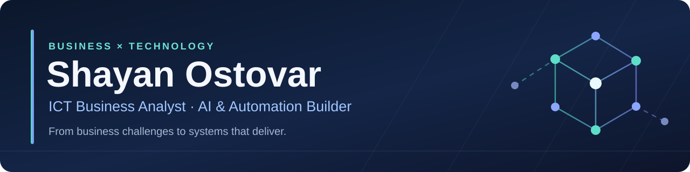
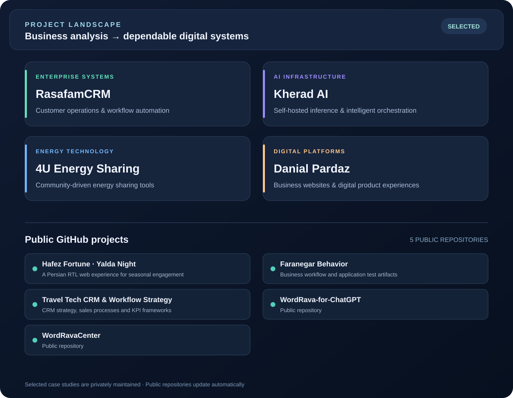

  

  **Business Analysis** · **AI Engineering** · **Enterprise Software** · **Automation**

  
  

### Hello, I'm Shayan 👋

I'm an **ICT Business Analyst** focused on turning complex business processes into practical software, AI-enabled workflows and reliable digital products.

I work across the whole path from **requirements and architecture** to **implementation, integration, deployment and iteration**. My priority is measurable business value rather than technology for its own sake.

## 🚀 Selected Work

| Project | What I'm building |
|:--|:--|
| **RasafamCRM** · Enterprise CRM | Business-process orchestration, CRM workflows, integrations and operational automation. |
| **Kherad AI** · AI Infrastructure | Self-hosted LLM services, model routing, AI job orchestration and GPU-based workloads. |
| **4U Energy Sharing** · Energy Tech | Tools for managing energy communities, provider/consumer matching and location-aware workflows. |
| **Danial Pardaz** · Digital Platforms | Business websites, administrative systems and digital customer experiences. |

These are selected product case studies. Their source repositories are private; public repository links appear below.

## 🛠️ Engineering Toolkit

**Application development**

**AI, automation & infrastructure**

**How I work:** Discover → Model → Design → Build → Automate → Measure

---

<!-- AUTO:START -->
## 🌐 Public Work & Project Map

A curated view of my work, plus an **automatically updated** index of public repositories.

### Public repositories

| Repository | Focus |
|:--|:--|
| [Hafez Fortune · Yalda Night](https://github.com/shayanostovar/Fal-e-HafezGenerator-YaldaNight) | A Persian RTL web experience for seasonal engagement |
| [Faranegar Behavior](https://github.com/shayanostovar/FaranegarBehavior) | Business workflow and application test artifacts |
| [Travel Tech CRM & Workflow Strategy](https://github.com/shayanostovar/TravelTechCrm-WorkFlowOptimization) | CRM strategy, sales processes and KPI frameworks |
| [WordRava-for-ChatGPT](https://github.com/shayanostovar/WordRava-for-ChatGPT) | Public repository |

Only publicly visible, non-archived repositories are listed. Private code and internal repository names are never indexed.

<!-- AUTO:END -->

---

## 👾 Contribution Arcade

<picture>
  <source media="(prefers-color-scheme: dark)" srcset="https://raw.githubusercontent.com/shayanostovar/shayanostovar/output/pacman-contribution-graph-dark.svg" />
  <source media="(prefers-color-scheme: light)" srcset="https://raw.githubusercontent.com/shayanostovar/shayanostovar/output/pacman-contribution-graph.svg" />
  
</picture>

Contributions animate through a daily GitHub Actions workflow.

---

  <strong>Have a challenge that needs a thoughtful technical solution?</strong> 
  <a href="https://github.com/shayanostovar">Connect with me on GitHub</a>

